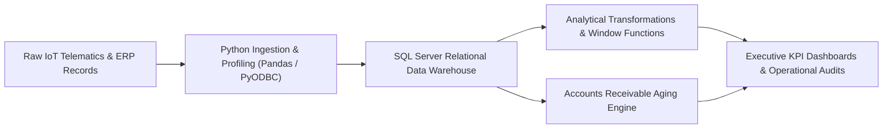

# GulfChill Logistics: Cold-Chain Data Warehouse & Analytics Engine

[](#)
[](#)
[](#)
[](#)

A production-grade relational data warehouse and analytical query engine engineered for **GulfChill Logistics**—a cold-chain transport provider managing refrigerated fleet telemetry, operational SLA tracking, and financial receivables settlement across the Gulf region.

---

## 📌 Architecture & Pipeline Flow



---

## 🏢 Business Context & Core Engineering Challenges

In cold-chain refrigerated logistics, operations face strict operational and compliance boundaries:
1. **Perishable Cargo Integrity:** Temperature excursions outside strict thresholds (`DEEP_FREEZE`: -18°C, `CHILLED`: 2°C to 8°C) ruin goods and breach SLAs.
2. **On-Time Delivery Compliance:** Dynamic lead-time tracking between scheduled and actual delivery stamps.
3. **Working Capital & Delayed Receivables:** Hundreds of active commercial accounts where delayed customer payments risk operational liquidity.

This repository provides the core relational architecture, automated quality audits, and high-performance T-SQL transformation pipelines to address these challenges.

---

## 🗄️ Relational Schema Design

The warehouse is structured around operational facts and dimension entities:

| Entity Name | Entity Type | Role & Key Metrics |
| :--- | :--- | :--- |
| `dbo.customers` | Dimension | Commercial accounts, contract tiers (`Gold`, `Silver`, `Bronze`), credit terms |
| `dbo.warehouses` | Dimension | Cold storage distribution hubs, temperature zones, sqm capacity |
| `dbo.vehicles` | Dimension | Refrigerated fleet (Reefer vans & heavy trucks), maintenance lifecycle |
| `dbo.drivers` | Dimension | Certified operators, home distribution centers, hire tenure |
| `dbo.shipments` | Fact | 6,500+ freight dispatches, pickup/drop-off timestamps, distance, pallet volume, revenue, fuel costs |
| `dbo.invoices` | Fact | 6,300+ billing statements, credit due dates, and settlement timestamps |
| `dbo.temp_readings` | Fact (IoT) | 14,000+ IoT sensor readings, excursion breach flags |
| `dbo.maintenance` | Fact | Fleet overhaul logs, repair costs, and odometer intervals |

---

## ⚡ Core Engineering Implementations

### 1. Accounts Receivable Aging Engine (`sql/02_ar_aging_pipeline.sql`)
Solves missing payment tracking via defensive NULL handling and multi-tier aging bucket classification:
* **Dynamic Effective Dates:** Utilizes `COALESCE(paid_date, CAST(GETDATE() AS DATE))` inside a high-efficiency derived table to evaluate active open debt without repeating calculations.
* **Lead-Time / Overdue Math:** Implements `DATEDIFF(DAY, due_date, realpaid_date)` to determine exact default durations.
* **Conditional Aging Logic:** Eliminates edge-case false positives by evaluating NULL states prior to overdue duration boundaries (`Still Unpaid`, `Paid Late`, `Paid Early`, `Paid On Time`).

### 2. Analytical Window Functions (`sql/03_window_functions.sql`)
Performs multi-partition fleet benchmarking and running metrics without table-locking `GROUP BY` operations:
* **Partitioned Ranking:** Compares `ROW_NUMBER()`, `RANK()`, `DENSE_RANK()`, and `NTILE(4)` to isolate high-value freight lanes and customer quartiles.
* **Top-N Partition Filtering:** Leverages Common Table Expressions (CTE) to extract the Top 3 shipments per customer.
* **Rolling Aggregations:** Computes cumulative customer revenue using frame clauses (`ROWS BETWEEN UNBOUNDED PRECEDING AND CURRENT ROW`) alongside partition means (`AVG() OVER()`) to evaluate freight margin variance.

### 3. Automated Data Quality & Profiling Suite (`scripts/data_profiling.py`)
A Python audit harness verifying data pipeline integrity:
* Evaluates primary key uniqueness across dispatch identifiers.
* Generates completeness ratios across nullable telematics stamps.
* Reports descriptive statistics for freight distance, pallet weights, and fuel consumption.

### 4. Cross-System Reconciliation Engine (`sql/04_system_reconciliation.sql`)
Two-way automated audit reconciling Transport Management System (TMS) dispatches against ERP financial billing:
* **Two-Way Skew Detection:** Leverages `FULL OUTER JOIN` to isolate unbilled deliveries (`MISSING_INVOICE`) and phantom billing records (`ORPHAN_INVOICE`).
* **Defensive Key Resolution:** Utilizes `COALESCE(s.shipment_id, i.shipment_id)` to preserve tracking references across orphaned records.
* **Audit State Attribution:** Segregates valid operational cancellations from unbilled pipeline backlog without false positive payment assumptions.

---

## 📁 Repository Structure

```text
gulfchill-data-pipeline/
├── README.md                          # Production architecture & documentation
├── .gitignore                         # Environment & data artifact exclusions
├── sql/
│   ├── 01_schema_ddl.sql             # Full DDL constraints, keys, and table definitions
│   ├── 02_ar_aging_pipeline.sql      # Accounts receivable reconciliation & aging engine
│   ├── 03_window_functions.sql       # Advanced analytical ranking and aggregate window queries
│   └── 04_system_reconciliation.sql  # TMS vs ERP reconciliation audit engine
└── scripts/
    └── data_profiling.py             # Python data quality audit and profiling suite
```

---

## 🚀 Setup & Execution

### Prerequisites
* Microsoft SQL Server (2019+ or SQL Express)
* SQL Server Management Studio (SSMS) or Azure Data Studio
* Python 3.10+ with `pandas` and `pyodbc`

### Local Deployment
1. **Clone the repository:**
   ```bash
   git clone https://github.com/ariafmeddison57-cmyk/gulfchill-data-pipeline.git
   cd gulfchill-data-pipeline
   ```

2. **Deploy Database Schema:**
   Open and execute `sql/01_schema_ddl.sql` inside SSMS against your local SQL instance.

3. **Run Financial & Analytical Pipelines:**
   Execute `sql/02_ar_aging_pipeline.sql` and `sql/03_window_functions.sql` to generate analytical views.

4. **Run Data Quality Profiler:**
   ```bash
   python scripts/data_profiling.py
   ```

---

## 👤 Author
**Ariaf Meddison**
* GitHub: [@ariafmeddison57-cmyk](https://github.com/ariafmeddison57-cmyk)
* Domain Focus: Data Engineering, Relational Data Modeling, T-SQL Analytics, ETL Pipelines
